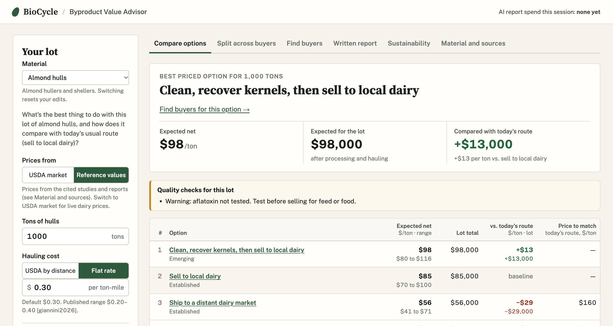

# BioCycle Byproduct Value Advisor

**For California processors with a lot of crop residue (almond hulls, grape pomace, orange peels and more): what's the best thing to do with this lot, how much more does it earn than today's usual route, and who would actually buy it?**



## What we built

A working web app (FastAPI + server-rendered HTML, no build step) that turns a lot description
into a ranked, sourced, decision-ready answer:

| Tab | What it does |
|---|---|
| **Compare options** | Ranks every outlet for the lot (feed, compost, biogas, extraction, biochar, materials…) by expected net $/ton after processing and hauling, with low–high ranges, the price a buyer would need to pay to beat today's route, and quality checks (aflatoxin, fiber, moisture). |
| **Find buyers** | 31 real California companies, each with the page and quote that show it handles the material, a fit label (strong / possible) and a ready-to-send quote-request draft. **Click any option on Compare to jump to the companies for that option.** |
| **Split across buyers** | Splits the lot across specific buyer quotes with a linear program (SciPy HiGHS) and reports the marginal value of one more ton. |
| **Written report** | Claude writes a plain-English report from the computed numbers. A guardrail checks every number in the text against the calculation and flags any that don't match. |
| **Sustainability** | Hauling and end-of-use emissions (EPA factors), position on EPA's Wasted Food Scale, PDF/Markdown export. |
| **Material and sources** | Composition, every cited source, literature evidence, and live USDA almond hull prices. |

**Eight materials:** almond hulls, almond shells, pistachio hulls, grape pomace, tomato pomace,
orange peels, mango peels, kiwi peels. Each has its composition, quality rules, 5–7 outlets and
its own baseline route (`data/biomass/<id>.yaml`).

**Design principles**
- **All math is deterministic Python.** The LLM only explains numbers the code already computed.
- **Every number has a source.** Values trace to `data/sources.yaml` (USDA, EIA, EPA, UC Davis,
  peer-reviewed papers in `data/evidence.yaml`), to the user's entry, or are marked as an
  estimate, and a banner appears whenever an estimate affects the answer.
- **Real data where it exists:** weekly USDA almond hull prices (181 weeks), USDA truck rates,
  DTN fertilizer prices for nutrient value.
- **Buyer directory is public business info only**: the loader rejects emails and phone
  numbers, and the app never contacts anyone.

## Run it

Requires Python 3.11+ (developed and tested on 3.13).

```bash
python3 -m venv .venv
.venv/bin/pip install -r requirements.txt
cp .env.example .env          # optional: add ANTHROPIC_API_KEY for the Written report tab
.venv/bin/uvicorn web.app:app --port 8000
# open http://localhost:8000
```

Everything except the Written report works with no API key and no network.

**60-second demo:** pick **Tomato pomace** in *Your lot* → change the tons and watch the
ranking update → click **Lycopene colorant and seed-oil / seed-meal extraction** in the table to see who
could buy it → open **Draft a quote request** → try **Split across buyers** and **Sustainability**.

## What we tested

| Layer | What it checks | Result | Command |
|---|---|---|---|
| **Unit + web tests** | 164 pytest tests: valuation math, allocation LP, data/evidence validation (units, source ids, no personal contacts), every material's page renders, every option links to its buyer list, report guardrail (LLM mocked) | **164/164 pass** | `.venv/bin/pytest -q` |
| **Math validation** | 6 hand-worked golden lots, 8 invariants on 300 random lots, LP vs. an independent greedy solver on 200 buyer sets, price backtest | **17/17 pass** | `.venv/bin/python -m evals.run math` |
| **Real-price backtest** | Replays the recommendation over 181 weeks of USDA hull prices (2022–2026) | Recommendation stable in all 181 weeks | `.venv/bin/python -m evals.run market` |
| **AI report eval** | 4 scenarios × 9 automated graders (every number traced, sections, citations, reading level…) + an LLM judge scoring faithfulness, clarity, honesty, risk coverage | Graders **4/4** on every check; judge mean 4.2–4.5 / 5, **3/4 pass** (grape pomace report flagged for a garbled sentence; logged for prompt work) | `.venv/bin/python -m evals.run report` |

Results are saved under [`evals/results/`](evals/results/). Method details are in
[`docs/EVALUATION.md`](docs/EVALUATION.md).

## Repository map

```
web/              FastAPI app: routes (app.py), Jinja templates, one vanilla JS file, CSS
biocycle/         Core logic, UI-free
  valuation.py      net value, ranges, break-even, quality flags
  allocation.py     buyer split (linear program) and dual values
  pathways.py       literature-backed conversion models (hydrothermal, yeast protein, feed value)
  directory.py      real-company directory + quote-request drafts
  report.py, llm.py Claude report, number guardrail, cost logging
  sustainability.py emissions summary
  refresh.py        pulls USDA / EIA market data
data/             All inputs as reviewable YAML/CSV
  biomass/          one profile per material
  sources.yaml      every cited source
  evidence.yaml     numbers extracted from papers, with the quoted sentence
  buyers_directory.yaml  real companies with evidence links
  market/           USDA/EIA snapshots
tests/            pytest suite
evals/            math validation, report graders, LLM judge, saved results
docs/             ARCHITECTURE.md (how the numbers work), EVALUATION.md, SPEC.md (original spec)
```

## Limitations

- Outside almond hulls, most prices are estimates: no public market exists, so users enter real
  buyer quotes (the app shows the price needed to beat today's route).
- Many buyer-directory entries are a "possible fit" (handles similar material); several options
  have no verified California buyer yet, and the app says so.
- Sample buyers in *Split across buyers* are fictional.

## More

- [docs/ARCHITECTURE.md](docs/ARCHITECTURE.md): formulas, data tiers, literature engine,
  market data, buyer allocation, web app internals.
- [docs/EVALUATION.md](docs/EVALUATION.md): how each evaluation layer works.
- [docs/SPEC.md](docs/SPEC.md): the original spec we built from.
